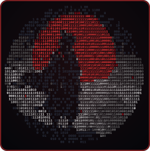

<div align="center">




<br/>

<a href="https://github.com/Paramveersingh-S">
  
</a>

<sub><code>01010000 01100001 01110010 01100001 01101101 01110110 01100101 01100101 01110010</code> &nbsp;·&nbsp; <i>decode me</i> 😉</sub>

<br/><br/>


<br/>

[](https://github.com/Paramveersingh-S)
[](https://github.com/search?q=is%3Apr+is%3Amerged+author%3AParamveersingh-S+-user%3AParamveersingh-S&type=pullrequests)
[](https://github.com/Paramveersingh-S?tab=repositories)

</div>

---

## `$ cat about.md`

```text
role        : Machine learning & systems engineer (student)
focus       : LLM inference · model serving · CUDA kernels · voice AI · agentic systems
also into   : embedded software · cyber security · kernel programming
open source : CERN-HSF (Phoenix) · vLLM · HSF Training · Hugging Face · ns-3
research    : 3 papers (IEEE-ICSPED, Springer, MRCN 2026)
status      : open to collaboration, research-paper analysis and internships
```

<table align="center" width="100%">
<tr>
<td width="50%" valign="top">

### 🔭 Right now
- 🧪 Contributing to **CERN-HSF [Phoenix](https://github.com/HSF/phoenix)**: event-display tooling and selective geometry slicing
- ⚡ Working on **LLM inference & serving** (vLLM ecosystem)
- 🌐 Network simulation fixes in **ns-3** (TCP / ECN)
- 🎙️ Building voice AI and agentic pipelines

</td>
<td width="50%" valign="top">

### 🎓 Programs
- 🌏 **U-Tokyo Matsuo-Iwasawa Lab**: Global Consumer Intelligence (GCI) Program
- 🧬 **CERN-HSF**: open-source contributor
- 💻 **GSSoC**: AI/ML track contributor
- 🛰️ **NASA Space Apps**: global nominee

</td>
</tr>
</table>

---

## 🚀 Featured projects

<div align="center">

<a href="https://github.com/Paramveersingh-S/Awaaz"></a>
<a href="https://github.com/Paramveersingh-S/Swizzle"></a>
<br/>
<a href="https://github.com/Paramveersingh-S/GateKeeper"></a>
<a href="https://github.com/Paramveersingh-S/CircuitPilot"></a>
<br/>
<a href="https://github.com/Paramveersingh-S/Semantic-search-RAG"></a>
<a href="https://github.com/Paramveersingh-S/Custom-HGEMM"></a>

</div>

<details>
<summary><b>More repositories worth a look</b></summary>
<br/>

| Repo | What it is |
|------|------------|
| [microgpt](https://github.com/Paramveersingh-S/microgpt) | Compact Llama-3-style small language model built from scratch in PyTorch |
| [Forge](https://github.com/Paramveersingh-S/Forge) | Rust-accelerated LLM fine-tuning |
| [Receipt](https://github.com/Paramveersingh-S/Receipt) | Verification and institutional memory for autonomous-agent PRs |
| [Cortexion](https://github.com/Paramveersingh-S/Cortexion) | Open hardware + software platform for V2V communication and telemetry |
| [oPHIGS](https://github.com/Paramveersingh-S/oPHIGS) | OpenPHIGS v1: CERN revamp of a modern 3D graphics engine |
| [SuchnaSetu](https://github.com/Paramveersingh-S/SuchnaSetu) | Bilingual, accessible prototype for India's RTI Online portal |

</details>

---

## 🤝 Organizations I've contributed to

<div align="center">

<a href="https://github.com/CERN"></a>&nbsp;&nbsp;
<a href="https://github.com/HSF"></a>&nbsp;&nbsp;
<a href="https://github.com/scikit-hep"></a>&nbsp;&nbsp;
<a href="https://github.com/hsf-training"></a>&nbsp;&nbsp;
<a href="https://github.com/vllm-project"></a>&nbsp;&nbsp;
<a href="https://github.com/huggingface"></a>&nbsp;&nbsp;
<a href="https://github.com/google-deepmind"></a>&nbsp;&nbsp;
<a href="https://github.com/google"></a>&nbsp;&nbsp;
<a href="https://github.com/fossunited"></a>

</div>

---

## 🛠️ Tech stack

<div align="center">


<br/>


<br/>


<br/>


</div>

---

## 📊 GitHub stats

<div align="center">


<br/>

<br/>

<br/>


</div>

---

## 🏆 Achievements & publications

<table align="center" width="100%">
<tr>
<td width="50%" valign="top">

### 🚀 Competitions & open source
- 🌍 **NASA Space Apps Challenge:** Global Nominee & Regional Winner (out of 18,868+ teams)
- 💻 **GSSoC:** selected contributor, AI/ML & open-source track
- 🥇 **IPD EXPO (2025):** 1st position among 30+ projects
- 🤖 **AI Hack Matrix (2026):** finalist among 300+ teams
- 🇮🇳 **India Innovates:** national finalist (35,000+ entries)

</td>
<td width="50%" valign="top">

### 📜 Research & academia
- 📘 **IEEE-ICSPED:** presented *"CHRONOS: A Chaos-Harnessed TRNG for Neural Initialization and Secure Key Synthesis"*
- 📙 **Springer (accepted):** *"AI Driven Sanskrit Character Recognition and Translating to Text and Audio Formats: A Step Towards IKS Revival"*
- 📗 **MRCN 2026 (accepted):** *"ML-Based Intrusion Detection for CAN Bus Networks in Autonomous Vehicles"*, 7th Intl. Conf. on Mobile Radio Communications & 5G Networks
- 🔬 **Internships:** CSIR-CSIO (software) · Yamada Automation (automation)

</td>
</tr>
</table>

---

## 💬 Let's build something

<div align="center">

Working on **LLM serving, GPU kernels, voice AI or open-source infra**? Want a second pair of eyes on a paper?

[](https://github.com/Paramveersingh-S/Paramveersingh-S/issues/new?title=Hello+%F0%9F%91%8B&body=I+found+your+profile+and+wanted+to+talk+about...)
[](https://github.com/Paramveersingh-S?tab=repositories&sort=stargazers)

<br/>


<sub><code>while (alive) { learn(); build(); ship(); }</code> &nbsp;·&nbsp; 不断の努力 <i>(continuous effort)</i></sub>

</div>

